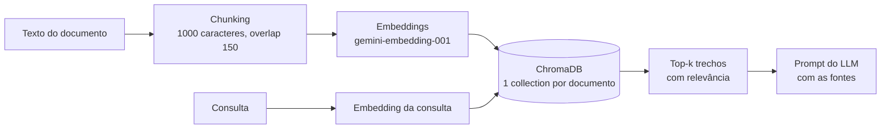

## Pipeline de RAG

O módulo RAG (`backend/app/rag/`) garante que o conteúdo gerado pelo NovaMente se apoie no documento original enviado pelo usuário. Ele divide o texto em trechos, transforma cada trecho em um vetor (embedding), guarda os vetores no ChromaDB e, na hora de gerar, devolve os trechos mais parecidos com a consulta para o LLM usar como fonte.

### Como funciona



| Etapa | O que faz | Arquivo |
|---|---|---|
| Chunking | Quebra o texto por parágrafo, linha, frase e palavra, nessa ordem de preferência, com sobreposição para não perder contexto na fronteira | `chunking.py` |
| Embeddings | Gera vetores de 3072 dimensões com `gemini-embedding-001` (`RETRIEVAL_DOCUMENT` na indexação, `RETRIEVAL_QUERY` na consulta), em lotes de 50, com nova tentativa em caso de erro 429 | `embeddings.py` |
| Armazenamento | Guarda os vetores no ChromaDB, uma collection por documento (`doc_<id>_<hash>`), com métrica cosseno | `armazenamento.py` |
| Serviço | Expõe as duas funções usadas pela API | `servico.py` |

Os valores (tamanho do chunk, overlap, limites de texto, `k` padrão) ficam em `config.py`.

### Como usar

```python
from app.rag import indexar_documento, recuperar

resultado = indexar_documento(
    documento_id="abc123",
    titulo="APIs REST",
    texto=texto_extraido,
    on_etapa=lambda etapa: print(etapa),  # "chunking" e depois "embeddings"
)
# resultado.total_trechos, resultado.caracteres

trechos = recuperar("abc123", "O que significa o erro 404?", k=4)
for t in trechos:
    print(t.indice, round(t.relevancia, 2), t.texto[:80])
```

| Função | Entrada | Saída |
|---|---|---|
| `indexar_documento(documento_id, titulo, texto, on_etapa=None)` | texto entre 200 e 50.000 caracteres | `ResultadoIndexacao` |
| `recuperar(documento_id, consulta, k=4)` | documento já indexado | lista de `Trecho` (`texto`, `indice`, `relevancia`, `documento_id`) |

**Erros:** `ValueError` quando a entrada é inválida (a API devolve HTTP 422) e `LookupError` quando o documento não foi indexado (HTTP 404).

**Relevância:** é `1 - distância cosseno`, limitada entre 0 e 1. Ela mede a proximidade vetorial entre o trecho e a consulta. Não é o `ancoragem_fonte_score` final, que combina essa distância com o LLM-as-a-judge e fica na camada de integração (veja *Pendências*).

### Configuração

| Variável | Para que serve |
|---|---|
| `GOOGLE_API_KEY` | Chave do Gemini, lida do ambiente. Nunca vai para o código nem para o repositório |
| `CHROMA_DIR` | Pasta do banco vetorial. Padrão: `/data/chroma`, fora do repositório |

Dependências do módulo: `backend/requirements-rag.txt`.

### Como testar

Os testes usam um embedding falso e **não chamam a API do Gemini**:

```bash
pytest backend/tests/rag
```

Para ver o RAG funcionando com o Gemini real, use os textos de `backend/data/exemplos/`. O script indexa o texto, faz perguntas e mostra os trechos com a relevância, usando uma pasta temporária:

```bash
export GOOGLE_API_KEY=...        # sua chave, sem colocar em arquivo versionado
python backend/scripts/demo_rag.py                      # http_apis_rest.md
python backend/scripts/demo_rag.py sql_consultas.md
python backend/scripts/demo_rag.py git_versionamento.md
```

### Cenários de demonstração

| # | Documento | Perguntas de teste | Resultado observado |
|---|---|---|---|
| 1 | `http_apis_rest.md` | "O que significa o erro 404?"; "Qual a diferença entre PUT e PATCH?"; "Como versionar uma API?" | _a preencher com a saída do script_ |
| 2 | `sql_consultas.md` | "Como encontrar clientes que nunca fizeram pedidos?"; "Quando usar HAVING em vez de WHERE?"; "Índices deixam o banco mais lento?" | _a preencher com a saída do script_ |
| 3 | `git_versionamento.md` | "O que acontece quando duas pessoas mudam a mesma linha?"; "Para que serve um pull request?"; "Qual a diferença entre merge e rebase?" | _a preencher com a saída do script_ |

### Pendências

- **Fluxo completo de ponta a ponta:** depende do modelo do Gemini configurado no backend e do frontend. Os cenários acima mostram só a parte do RAG.
- **`ancoragem_fonte_score`:** hoje o backend usa a relevância média. O documento oficial pede combinar a distância vetorial com o LLM-as-a-judge e reescrever o conteúdo quando o score fica abaixo de 0,85.
- **Limpeza:** as collections do Chroma ainda não são removidas depois do job (o módulo já tem `remover_documento`).
